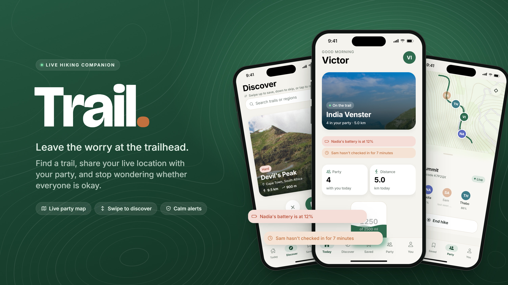
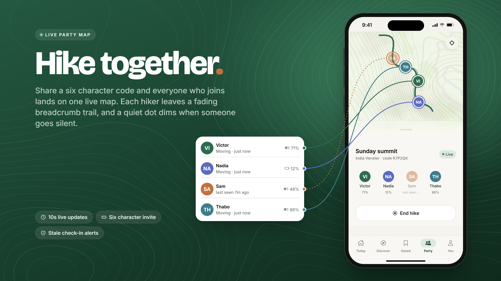
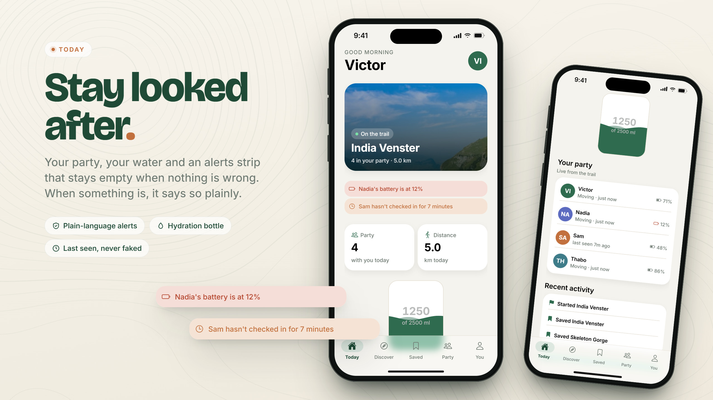
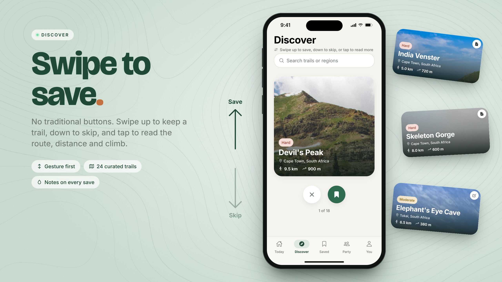
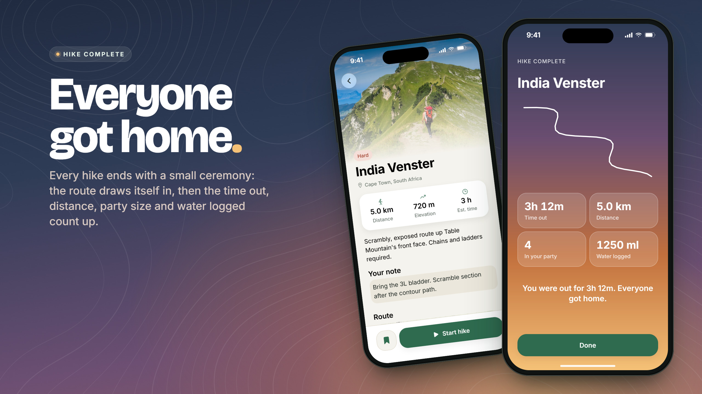
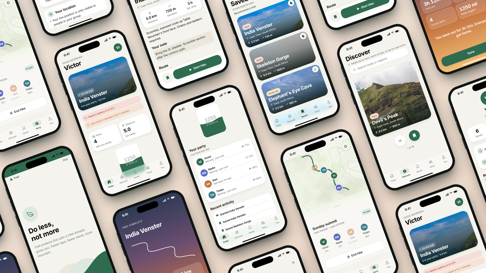
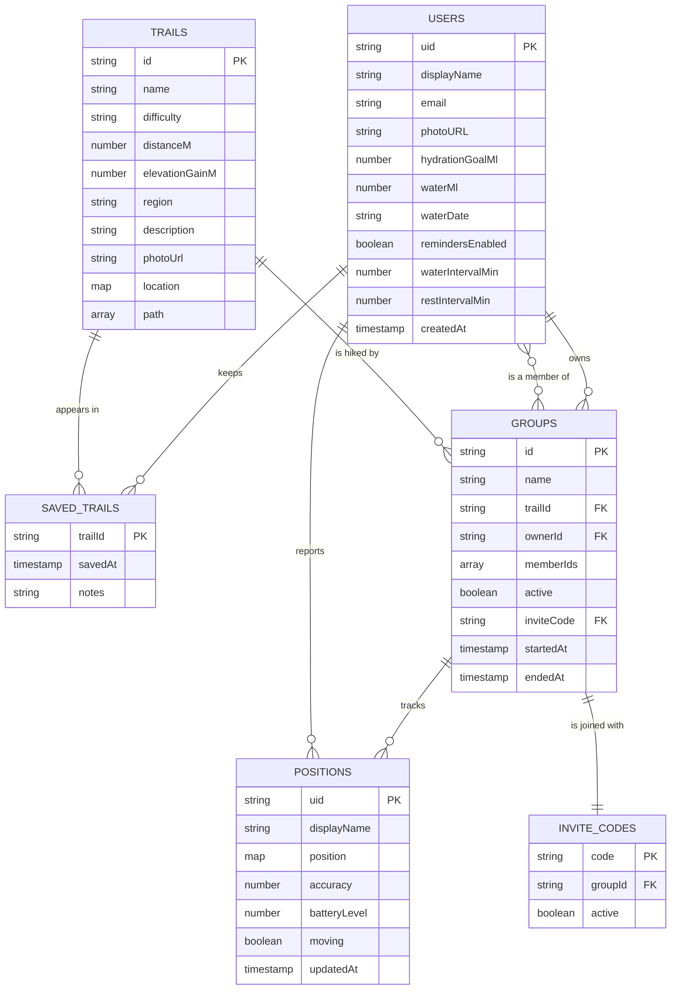

<div align="center">


# Trail · Mobile app

**Victor du Preez · 241250**

</div>

**Contents**

- [About](#about)
- [Getting started](#getting-started)
- [Features](#features)
- [Development process](#development-process)
- [Final outcome](#final-outcome)
- [Conclusion](#conclusion)

## About

Trail is a mobile app for hiking with less stress. Time on a trail should lower stress, but small
worries get in the way. Am I still on the path? Is everyone okay? Have I had enough water?

Trail takes on those worries. You find a trail, start a hike and share a six character code.
Everyone who joins appears on one live party map, so nobody has to wonder where anyone is. If
someone goes quiet or runs low on battery, the app says so plainly. If nothing is wrong, it stays
out of the way.

Three cards drawn at random shaped the idea: reduce stress, use geolocation, and avoid traditional
UI buttons.



**Built with**


## Getting started

### Prerequisites

| Tool                               | Needed for                             |
| :--------------------------------- | :------------------------------------- |
| Node.js 22 or newer, with npm      | Everything                             |
| Expo Go on an Android or iOS phone | Running the app                        |
| Java 21                            | `npm run test:rules` only              |
| A Firebase project                 | Only if you run your own backend       |
| A Firebase service account key     | Only for `npm run seed` and `simulate` |

### Run the demo

The demo needs no Firebase setup. It connects to a hosted database that is already seeded with
trails and has its rules published.

> `frontend/.env` is committed on purpose for assessment, so the real app runs from a clean clone.
> It holds Firebase's public client configuration only. It has no service account key or private
> secret, and the rules in `backend/` control access. In any real project this file stays untracked.

1. Clone the repo and install the frontend:

   ```bash
   git clone https://github.com/victordupreez0/Trail.git
   cd Trail/frontend
   npm install
   ```

2. Start the app:

   ```bash
   npm start
   ```

3. Scan the QR code with Expo Go, on the same WiFi as your computer. If the WiFi blocks phone to
   laptop traffic, which most campus networks do, use `npm run start:tunnel` instead.

**Demo admin account.** Use this shared account to open **You → Admin → Manage trails**:

```text
Email:    admin@gmail.com
Password: admin123
```

This is a hand-in-only account. Do not reuse its password anywhere else.

### Set up your own Firebase backend

Skip this section to use the demo backend.

1. In the [Firebase console](https://console.firebase.google.com), create a project and add a
   **Web app**.
2. Under **Authentication**, enable **Email/Password**.
3. Create a **Cloud Firestore** database and a **Storage** bucket. Firebase may ask you to move to
   the Blaze plan for Storage.
4. Replace the six values in `frontend/.env` with the Web app values from your project settings.
5. Publish the rules and indexes. Firestore denies every read and write by default, so the app
   looks broken until this is done.

   ```bash
   cd frontend
   npx firebase login
   npx firebase --config ../firebase.json deploy --project YOUR_PROJECT_ID --only firestore:rules,firestore:indexes,storage
   ```

6. Create a service account key under **Project settings → Service accounts** and keep it outside
   this repo. Set `GOOGLE_APPLICATION_CREDENTIALS` to its path, then seed the trails from
   `frontend/`:

   ```bash
   npm run seed
   ```

7. The rules treat `admin@gmail.com` as the admin. Sign up with that email on your project to use
   the admin screen.

### Try the live map with one phone

`backend/simulate-hiker.ts` walks simulated hikers along a trail and writes their positions to
Firestore every five seconds. Start a hike in the app, then run this from `frontend/` with the
invite code shown on the Party tab:

```bash
npm run simulate -- --code=ABC123
```

The script uses the Admin SDK, so it needs either `GOOGLE_APPLICATION_CREDENTIALS` or
`gcloud auth application-default login`.

The hikers follow your hike's trail. If you are not near it, they walk the same route starting from
where you are. After 30 seconds one of them goes quiet for three minutes, so the stale alert fires
at about the two minute mark and clears when they return. Ctrl-C cleans up after itself.

Optional flags: `--members=2`, `--trail=<id>`, `--speed=3`, `--quiet-after=30` and `--quiet-for=180`
(both in seconds).

### Other commands

```bash
cd frontend
npm run typecheck     # tsc, strict
npm run lint          # eslint
npm test              # unit tests
npm run test:rules    # security rules against the Firestore emulator (needs Java 21)
```

## Features

### Live party map

Start a hike and share a six character code. Everyone who joins appears on one map, and each person
leaves a fading breadcrumb trail. If someone stops checking in, their avatar dims and their row
reads "last seen 4m ago" instead of pretending the pin is current.



### Today

Today shows your party, your water and an alerts strip. The strip stays empty when nothing is
wrong. When something is, it says so plainly: someone has not checked in for two minutes, or their
battery is low. Tap the bottle to log water. Calm reminders run during a hike, on your own schedule.



### Discover and save

Swipe up to save a trail, swipe down to skip it, or tap to read the route, distance and climb. Save
and skip buttons sit under the deck for anyone who prefers to tap. Saved trails keep your own notes.
Removing one gives you four seconds to undo.



### Hike summary

Ending a hike opens a summary. The route draws itself in, then the time out, trail length, party
size and water for the day count up.



### The rest of the app

Trail also has email sign up with password reset, a three slide onboarding that shows once per
account, a profile photo, a safety screen, and an admin screen for the trail catalogue. Starting a
hike away from the trailhead shows a warning first.



## Development process

### Architecture

```
frontend/     self-contained Expo app
  app/          screens, one file per route (expo-router)
  src/          components, screens, hooks, Firebase, state and theme
  assets/       icons, splash art and bundled trail photos
backend/      security rules, rules tests, seed and simulation scripts
docs/         my annotated pitch, design spec and demo checklist
```

Five main screens sit in one swipeable pager: Today, Discover, Saved, Party and You. Firestore
listeners and React Context hold the app state. During a hike, each phone writes its own position
to Firestore and listens to the positions of everyone else in the group.

### Data model

```
users/{uid}                        displayName, email, photoURL, hydrationGoalMl,
  └── savedTrails/{trailId}          waterMl, reminder settings
                                     savedAt, notes

trails/{trailId}                   name, difficulty, distanceM, elevationGainM,
                                     location, path

groups/{groupId}                   name, trailId, ownerId, memberIds[], active,
  └── positions/{uid}                inviteCode, startedAt, endedAt
                                     position, accuracy, batteryLevel, moving, updatedAt

inviteCodes/{CODE}                 groupId, active
```

That last collection is there for a specific reason. A group can only be read by its own members,
so somebody joining by code cannot query groups by `inviteCode`, because they are not a member yet.
`inviteCodes` is a small public mirror that gets them from a code to a group id without opening the
group itself up to the world.



### Design summary

**Moodboard.** A calm outdoor look: warm paper backgrounds, forest greens and a muted terracotta
accent. Only danger alerts are allowed to stand out.

**Wireframes.** The [project pitch](docs/annotated-241250_Victor_du_Preez_DV300_S2_A1_Project%2520Pitch.pdf)
wireframes four key screens: Home and Map, Trail Detail, Discover, and the live group view. It also
sets the accessibility goals: one-handed use, contrast for sunlight, large tap targets, haptics and
reduced motion.

### Key decisions

**Gesture first.** The brief's constraint was no traditional UI buttons, so the main actions are
gestures. You swipe to save, skip and move between screens. Buttons stay where a tap has to be
unambiguous, such as starting or ending a hike.

**Tab bar kept for usability.** The pitch planned a pager with no tab bar. I kept the pager and
added a tab bar over it. Gestures are the shortcut and the tab bar is the map. An app used one-handed
on a mountain cannot hide its navigation.

**10-second updates and a heartbeat.** While a hiker moves, their phone writes a position at most
every 10 seconds. A phone standing still fires no location events, so a heartbeat re-sends the last
fix every 30 seconds. Party screens re-check every 10 seconds, and two minutes of silence dims that
person and raises an alert. Firestore listeners met this target alone, so I dropped the Realtime
Database channel from the pitch.

### Challenges

- **Joining a private group.** A joiner is not yet a member, so the rules block them from finding
  the group by its code. The `inviteCodes` collection solves this without making groups public.
- **Background tracking.** The original plan used background location, but that needs a custom
  native build. I chose foreground tracking so that anyone can run the app from a QR code in Expo Go.
- **A quiet phone looks like a lost phone.** Someone resting sends no location events, so the
  heartbeat keeps them from being marked as stale.
- **Gestures that compete.** A sideways drag on the live map has to pan the map and not change the
  tab, so page swiping turns off on the Party screen during a hike.
- **A swipe deck that skipped cards.** Each save used to skip the next trail. The deck now reads
  the first undecided trail by id.
- **A CI step that always failed.** The rules test config could not find its tests, so
  that CI step always failed until I fixed the config.

### Security rules

Location data needs rules that are tested and not assumed. `backend/rules.test.ts` runs 18 cases
against the Firestore emulator in CI. For example, a non-member cannot read a group, a member cannot
write another member's position, and only a hike's owner can retire its invite code.

| Path                               | Read               | Write                                                        |
| :--------------------------------- | :----------------- | :----------------------------------------------------------- |
| `users/{uid}` and `savedTrails`    | That user          | That user                                                    |
| `trails/{trailId}`                 | Any signed-in user | Admin only                                                   |
| `groups/{groupId}`                 | Group members      | Owner, or a user adding only their own id to `memberIds`     |
| `groups/{groupId}/positions/{uid}` | Group members      | That member only                                             |
| `inviteCodes/{CODE}`               | Any signed-in user | Any signed-in user can create. Only the owner can deactivate |
| Storage `avatars/{uid}`            | Any signed-in user | That user. Images only, up to 5 MB                           |

The admin check compares one demo email address. A production app would use custom claims. Only a
hike's owner can end it, and members cannot leave a group, because the rules let a person add their
own id but never remove it.

## Final outcome

| Test suite      | Command                  | Result                    |
| :-------------- | :----------------------- | :------------------------ |
| Unit and screen | `npm test -- --coverage` | **135 passed**, 16 suites |
| Security rules  | `npm run test:rules`     | **18 passed**, 1 suite    |

The security rules result comes from
[GitHub Actions](https://github.com/victordupreez0/Trail/actions/runs/42486165003), on commit
`805ebbc`.

| Coverage             | Statements | Branches | Functions | Lines  |
| :------------------- | :--------- | :------- | :-------- | :----- |
| `src/lib`, all files | 80.55%     | 76.63%   | 70%       | 80.79% |

Coverage counts every file in `src/lib`, which holds the app's logic. Screens and components are not
in these numbers. Native maps, gestures and animation are checked by hand on a phone.

<details>
<summary><b>Coverage by file</b></summary>

| File             | Statements | Branches | Functions | Lines  |
| :--------------- | :--------- | :------- | :-------- | :----- |
| `adminTrails.ts` | 0%         | 100%     | 0%        | 0%     |
| `auth.ts`        | 0%         | 0%       | 0%        | 0%     |
| `authMessage.ts` | 100%       | 100%     | 100%      | 100%   |
| `catalog.ts`     | 100%       | 100%     | 100%      | 100%   |
| `firebase.ts`    | 0%         | 0%       | 0%        | 0%     |
| `groups.ts`      | 89.28%     | 62.5%    | 72.72%    | 88.88% |
| `haptics.ts`     | 50%        | 100%     | 20%       | 50%    |
| `hikeSummary.ts` | 93.1%      | 76.92%   | 100%      | 100%   |
| `hydration.ts`   | 100%       | 100%     | 100%      | 100%   |
| `inviteCode.ts`  | 100%       | 100%     | 100%      | 100%   |
| `party.ts`       | 100%       | 95.83%   | 100%      | 100%   |
| `positions.ts`   | 100%       | 100%     | 100%      | 100%   |
| `profile.ts`     | 0%         | 0%       | 0%        | 0%     |
| `reminders.ts`   | 100%       | 100%     | 90%       | 100%   |
| `savedTrails.ts` | 100%       | 100%     | 100%      | 100%   |
| `simulation.ts`  | 100%       | 92.85%   | 100%      | 100%   |
| `swipe.ts`       | 100%       | 100%     | 100%      | 100%   |
| `trailhead.ts`   | 100%       | 100%     | 100%      | 100%   |
| `userDoc.ts`     | 80%        | 66.66%   | 57.14%    | 78.57% |
| `wave.ts`        | 100%       | 66.66%   | 100%      | 100%   |

</details>

## Conclusion

**Highlights**

- Three random cards became one clear idea: a safety app reframed as a calm one.
- A shared live map keeps a whole party in view, and shows plainly when someone goes quiet.
- The location rules are tested against the emulator, not just written.
- Anyone can run the app from a QR code, with no native build and no Firebase setup.

**Challenges**

- Location sharing had to be private by default and still let a new person join by code.
- Maps, gestures and notifications cannot be proven by unit tests, so they need testing on a phone.
- Tracking only runs in the foreground, and trail routes are simplified lines and not recorded GPX
  tracks.

**Future improvements**

- Plant and bird identification from a photo.
- Offline trail maps.
- Background tracking, using a custom native build.

---

**License.** MIT License. Copyright (c) 2026 Victor du Preez. See [LICENSE](LICENSE).

**Author.** Victor du Preez · 241250 · Interactive Development 300 · Open Window · 2026 ·
[victor.dupreez0@gmail.com](mailto:victor.dupreez0@gmail.com)

**Acknowledgements**

- **AI tools:** Claude and [Claude Code](https://claude.com/claude-code) by Anthropic, used for the
  final bug audit, fixes, tests, documentation and the mockup images in this README.
- **Trail photography** from [Unsplash](https://unsplash.com), used under the Unsplash licence.
- **Icons** from [Ionicons](https://ionic.io/ionicons) via `@expo/vector-icons`.
- **[Expo](https://docs.expo.dev)** and **[React Native](https://reactnative.dev)** documentation.
- **[Firebase documentation](https://firebase.google.com/docs)**, particularly the security rules
  guide and the rules unit testing library.
- **[Reanimated](https://docs.swmansion.com/react-native-reanimated/)** and
  **[Gesture Handler](https://docs.swmansion.com/react-native-gesture-handler/)** documentation by
  Software Mansion.
- **Trail data** for the Cape Town routes, cross-referenced against SANParks and public trail
  guides.
- **DV300 lecturer:** Tsungai Katsuro.
